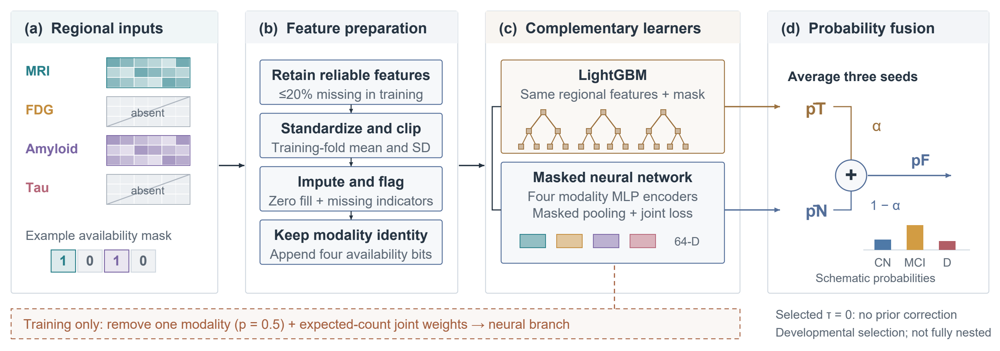

# AVF: Availability-Aware Fusion

Research code for **joint class imbalance and modality imbalance** in ADNI regional-feature classification. MRI, FDG, amyloid and tau ROI blocks may be absent. AVF fuses a LightGBM seed ensemble with a jointly weighted, modality-dropout masked neural network.



**Scope:** ROI/tabular regional features, not raw-image encoders. The archived findings are exploratory development results. Checkpoint validation was reused, fusion selection was not fully nested, and no independent final-test superiority is established. The proposed fusion improves F1 and supported-cell recall; the AUROC gain is small and uncertain.

## Frozen findings

Natural availability; 9,566 visits, 2,260 participants; pooled participant-grouped development predictions after three-seed averaging.

| Method | Macro-AUROC | Macro-F1 | Balanced accuracy | SCR |
| --- | ---: | ---: | ---: | ---: |
| LightGBM seed ensemble | .794 | .601 | .595 | .568 |
| Joint-weighted neural + modality dropout | .778 | .593 | .621 | .585 |
| AVF | .797 | .619 | .625 | .604 |

Paired participant-bootstrap intervals for AVF minus LightGBM: F1 +.01803 [.01021, .02559]; SCR +.03577 [.02027, .05145]; AUROC +.00318 [−.000052, .00610]. The intervals condition on fitted/selected models and do not adjust for exploration or selection. Class-weighted fusion slightly exceeds AVF in F1/AUROC. Full controls are in [the paper](paper/main.pdf) and [aggregate results](results/natural_results.csv).

## Install and smoke check

Python 3.10+; install a PyTorch build suitable for your CPU/CUDA environment, then:

```bash
python -m pip install -e .
python -m unittest discover -s tests -v
python scripts/synthetic_demo.py
```

The demonstration uses generated synthetic data and a random tree-probability placeholder. It verifies wiring and a neural gradient step; it is **not** an ADNI experiment or a LightGBM performance result.

## Code and provenance

- `src/avf/executed_components.py`: verbatim extracted MaskNet, dropout, weighting, preprocessing and optional-correction definitions from the archived study. Source hashes and definition spans are in `docs/CODE_PROVENANCE.json`.
- `src/avf/fusion.py`, `metrics.py`: release wrappers with input checks and documented semantics.
- `scripts/train_roi_development.py`: newly assembled training orchestration for authorized local data, with the archived development settings. It is not the historical executed driver and has not produced the archived scores.
- `scripts/replay_private_predictions.py`: local-only replay of the fixed archived mixtures from aligned private probabilities.
- `scripts/build_pipeline_figures.py`: vector stage diagrams from published aggregate counts. Identical typography uses Arial; ReportLab Vera is a fallback.

See [reproduction scope](docs/REPRODUCIBILITY.md), [input schema](docs/DATA_SCHEMA.md), [mathematical audit](docs/MATH_AUDIT.md) and [reference audit](docs/REFERENCE_AUDIT.md).

## Authorized private-data workflows

No ADNI participant records, identifiers, individual predictions, scans, fitted preprocessing statistics or checkpoints are distributed here. Only study-level metrics and aggregate cell counts/recalls are provided. Obtain ADNI data through its authorized access process and prepare the development partition locally.

```bash
python scripts/train_roi_development.py --data-dir /private/development_roi --output-dir local_outputs/run1 --device cuda
python scripts/replay_private_predictions.py --tree-csv /private/tree.csv --neural-csv /private/joint_drop.csv --frozen-folds-confirmed
```

Do not use archived fold alphas on a new cohort as if they had been validated there. For future confirmatory evaluation, keep all preprocessing, checkpoint selection, objective/fusion tuning and model choice inside each outer training set, then assess the locked procedure on untouched subjects.

## Paper and reuse

[Manuscript PDF](paper/main.pdf), LaTeX sources, bibliography and editable vector figures are in `paper/`. Highlights are separate. Install the official Elsevier CAS class and numeric bibliography style to compile; template dependencies are not vendored. `CITATION.cff` describes this unpublished research software, not an accepted journal article.

The repository's own code is MIT licensed. Manuscript copyright remains with its authors; third-party template dependencies retain their original licenses. Generative AI assisted implementation, analysis and writing, as disclosed in the paper. The authors remain responsible for verification.
